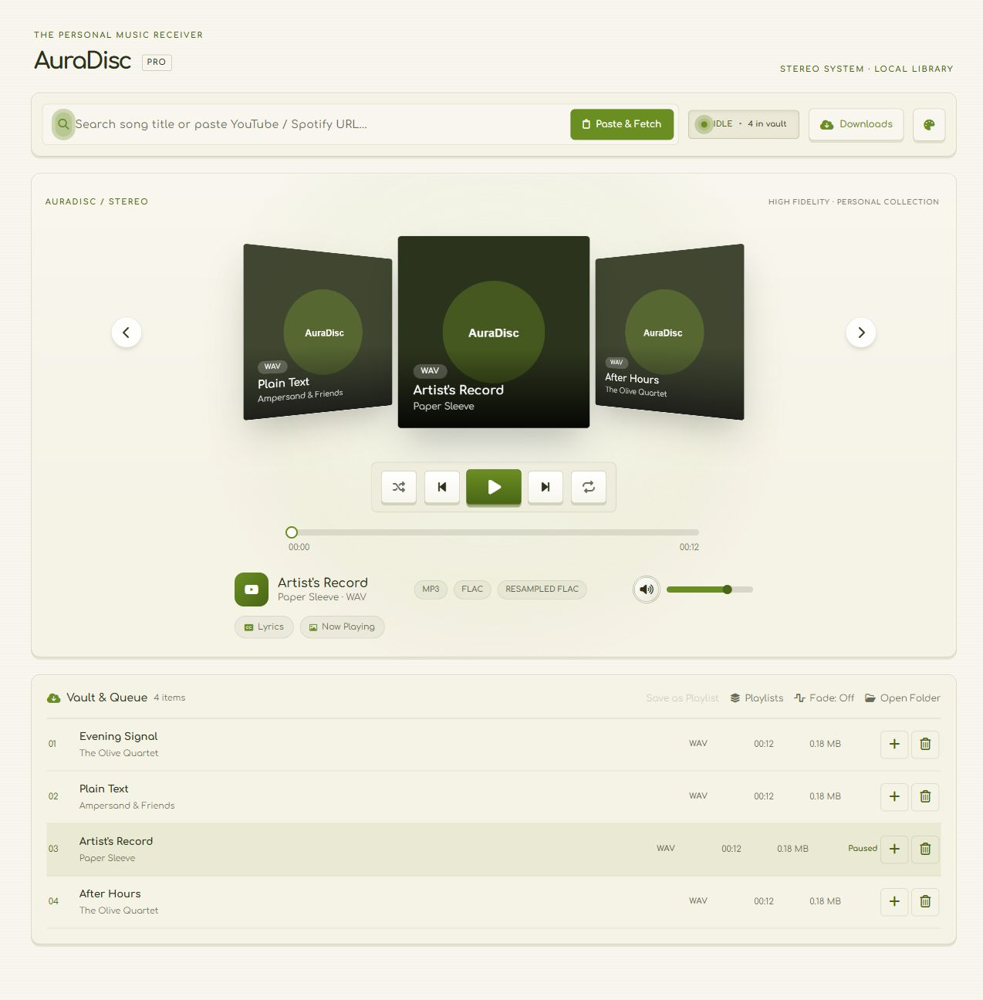
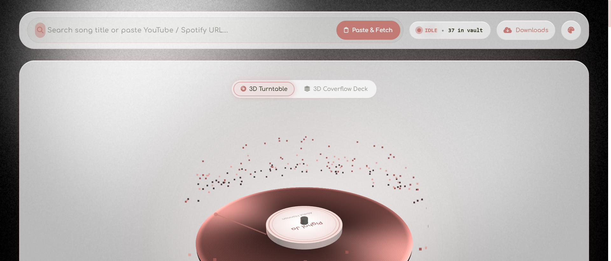
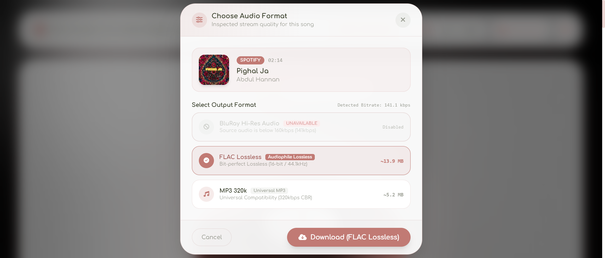
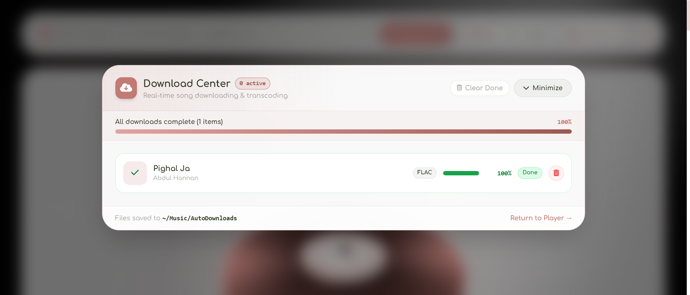
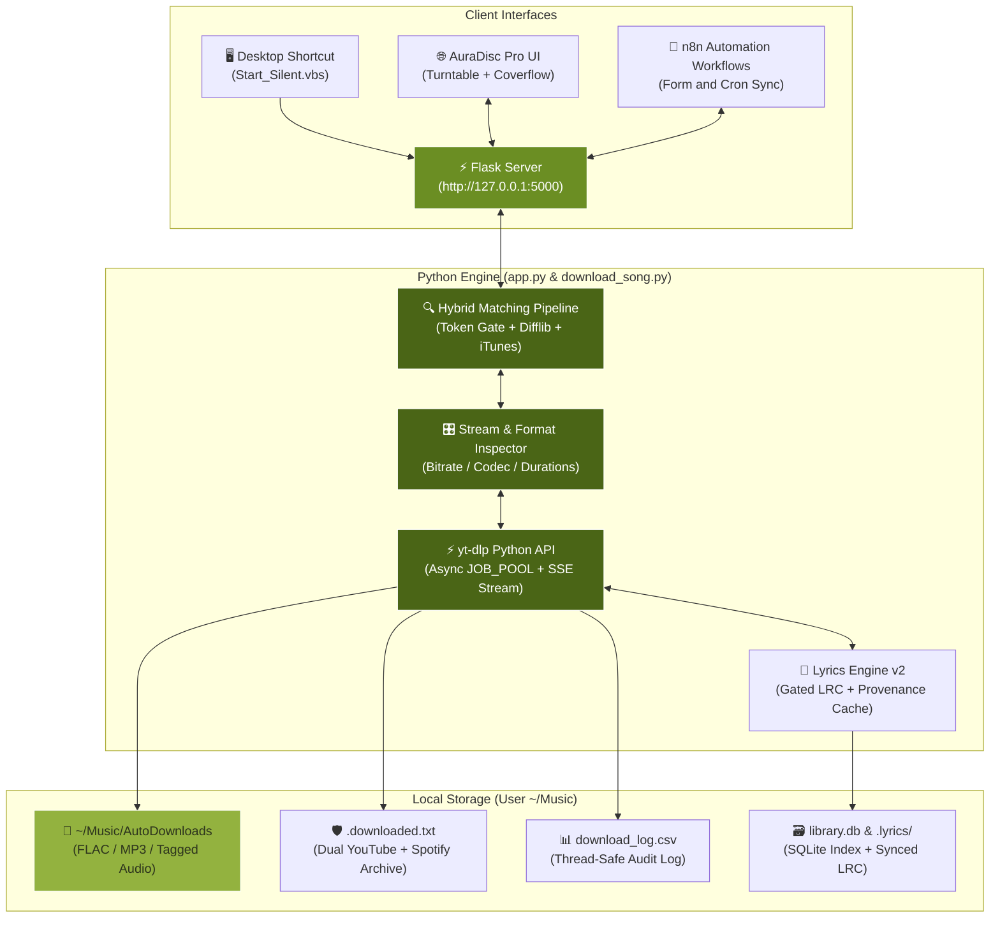

# 🎵 AuraDisc Pro — Automated Song Downloader & Music Hub

<div align="center">


[](https://python.org/)
[](https://flask.palletsprojects.com/)
[](https://github.com/yt-dlp/yt-dlp)
[](https://threejs.org/)
[](https://n8n.io/)
[](https://docs.pytest.org/)
[](https://microsoft.com/)

**A local music downloader and cream-and-olive hi-fi receiver, with a Coverflow deck, fullscreen karaoke, and n8n automation — for Windows.**

Current audit fixes, verification instructions, and remaining runtime limits: [Implementation notes](IMPLEMENTATION_NOTES.md).

[Features](#-key-features) • [Visual Previews](#-visual-previews) • [Architecture](#-system-architecture) • [Matching Pipeline](#-hybrid-matching--format-pipeline) • [API Reference](#-api-reference) • [Setup](#-installation--setup)

</div>

---

## 📸 Visual Previews

<div align="center">

### Current Retro Receiver (synthetic preview tracks)


The remaining screenshots below are historical and may show superseded controls or quality labels.

### Historical Player Preview (before the retro receiver update)


### Real-Time Stream Inspection & Format Selection Modal


### Live Download Center & Queue


</div>

---

## ✨ Key Features

### 1. 🔍 Hybrid Matching Pipeline (Option A)
- **Hard Title Token & Fuzzy Gates**: Disqualifies candidates with < 35% title token overlap by applying a -1000.0 penalty. High view counts (e.g. viral hits with 90M+ views) can never override the user's actual requested song.
- **Phonetic & Transliteration Normalization**: Cleans bracketed tags, video noise (`[Official Audio]`, `(Official Music Video)`), repeated vowels/letters (`jaa` ↔ `ja`, `mein` ↔ `me`), and leverages `difflib` similarity (>= 0.80) to match transliteration variants (e.g. *muntasir* ~ *muntazir*).
- **YouTube Music `- Topic` Preference**: Prioritizes official audio releases. Source selection does not establish studio-master fidelity or lossless quality.
- **Adaptive Duration Window**: Seamlessly accommodates cinematic music video intros/outros for official videos (±50s to ±85s) when title overlap is high (>= 70%).
- **Canonical Pre-Resolution via iTunes Search**: Plain-text searches query the iTunes Search API to resolve canonical track metadata (`title`, `artist`, `duration`, HD 600x600 artwork) for instant spelling correction.
- **Full Spotify Single & Album Fidelity**: Seamlessly processes both direct Spotify track links and 1-track single albums, passing structured `target_title` and `target_artist` throughout the entire download pipeline.

### 2. 🎛️ Real-Time Dynamic Stream & Audio Format Inspection
- **Inspect Stream Bitrate & Codecs**: Inspects source audio streams before downloading to determine maximum available bitrate (`max_abr`) and sample rate (`max_asr`).
- **Output Conversion Choices**:
  - **Resampled FLAC (96kHz)**: A larger converted file; resampling cannot restore missing source information. Legacy `bluray` API format identifiers remain supported.
  - **FLAC**: Lossless output encoding; the original source may be lossy.
  - **MP3**: High-quality VBR by default, with broad player compatibility.
- **MP3 Default**: Format selection is explicit; unknown source bitrate is shown as unknown.
- **Dedicated Single-Track Format Modal**: Displays track artwork, artist, title, duration, stream bitrate, and format cards before triggering download.
- **Clean Command Bar**: Static format buttons removed from the top header for a clean, full-width search input.

### 3. 🎨 AuraDisc Pro 3D Player & Coverflow Deck
- **AuraDisc Pro Design System**: White base + olive green accents (`#6B8E23`), Comfortaa typography app-wide, and Noto Nastaliq Urdu for authentic Urdu typography.
- **Retro Receiver Faceplate**: Cream surfaces, olive readouts, tactile transport keys, and static paper texture. The existing Coverflow layout is retained; the continuous WebGL background is removed.
- **3D Coverflow Carousel Deck**: Interactive 3D coverflow carousel with 3D perspective tilt, smooth gliding, keyboard navigation, and cover art reflections.
- **Self-Hosted & Offline-First**: Zero external CDNs at runtime. Tailwind Play runtime, Three.js, and FontAwesome 6.5.2 are fully vendor-bundled locally in `static/`.

### 4. 📥 Download Center & Resilient Async Queue
- **Async ThreadPool Queue**: Downloads run in the background; UI streams real-time status and progress over **Server-Sent Events (SSE)** (`/api/jobs/<id>/events`).
- **Dedicated Download Center Modal**: View individual card progress bars, active count badges, and overall batch progress.
- **Recovery**: SSE reconnects with a polling fallback; refreshing the page restores in-memory server jobs. Failed downloads show their error and a retry action.
- **Individual Remove & Dismiss Controls**: Completed, failed, or cancelled downloads feature a dedicated trash button to dismiss individual items, plus a top 'Clear Done' button.
- **Reliable Terminal State Events**: SSE stream reliably communicates job completion and skips duplicate archived downloads with instant **100% Done** updates.

### 5. 🎤 Dual-Language Karaoke Lyrics
- **Synced `.lrc` Playback**: Stacked **Urdu Nastaliq + English/Roman** lines, auto-scrolling highlight, and click-to-seek.
- **Fullscreen Karaoke Mode (`F` / `V`)**: Immersive fullscreen view with smooth edge gradient fade masks, high-resolution artwork card with 3D hover tilt, and an 'Up Next' playlist side drawer.
- **Correctness-First Lyrics Engine v2**: Synced LRC only; candidates are strictly gated on **duration (±12s vs real audio file)** and title/artist token overlap.
- **Provenance & Negative Cache**: Negative results cached in `.lyrics/.index.json` to skip redundant network requests for 7 days. On-demand transliteration and Google translation generators.

### 6. 🎧 SQLite-Indexed Library & Playlists
- **Indexed Library (`~/Music/library.db`)**: Tracks play counts, real durations via Mutagen, and search history while keeping the filesystem as the single source of truth.
- **Playlists & M3U Export**: Create and manage custom playlists, filter library rows, and export standard `.m3u` files.
- **Media Session API**: Full Windows media keys and lock-screen controls integration with procedural label artwork.

### 7. 🤖 n8n Automation & 1-Click Launch
- **n8n Workflows**: Includes ready-to-import workflows for batch downloading from web forms (`n8n_workflow.json`) and automated cron playlist sync (`n8n_watch_workflow.json`).
- **1-Click Silent Desktop Launcher**: Launch silently on Windows via `Start_Silent.vbs` without opening persistent command prompt windows.

---

## 🛠️ System Architecture



---

## 🔄 Hybrid Matching & Format Pipeline

```mermaid
flowchart LR
    In["Input: Query / Spotify / YouTube URL"] --> Type{"URL or Text?"}
    
    Type -->|"Spotify URL"| Sp["Extract Title, Artist, Duration
(Embed / API Scrape)"]
    Type -->|"Text Query"| iT["iTunes Search API
(Canonical Spelling Pre-Resolution)"]
    Type -->|"Direct YouTube"| Yt["Direct Stream Inspection"]
    
    iT -->|"Resolved Metadata"| Top["Stage 1: YouTube Music Topic Search
(Title Artist Topic)"]
    Sp -->|"Resolved Metadata"| Top
    iT -->|"No Match"| YtFlat["Stage 2: Flat Candidate Search
(ytsearchN with Difflib)"]
    
    Top -->|"Score >= 65"| Pick["Best Candidate Picked"]
    Top -->|"Score < 65"| YtFlat
    YtFlat --> Gate{"Hard Title Gate
(Token Match >= 35%?)"}
    Gate -->|"Yes"| Pick
    Gate -->|"No (-1000 pts)"| Disq["Candidate Disqualified"]
    
    Pick --> Insp["Stream Quality Inspection
(Measure max_abr & max_asr)"]
    Insp --> Modal["Open Format Selection Modal
(Pre-select Highest Quality)"]
    Modal --> Dl["Async Download & Tagging
(Mutagen ID3 + LRC Fetch)"]

    style Top fill:#6B8E23,stroke:#fff,color:#fff
    style Modal fill:#4A6516,stroke:#fff,color:#fff
    style Dl fill:#93B23F,stroke:#fff,color:#2C331D
```



---

## 📡 API Reference

| Method | Endpoint | Description | Payload / Response |
| :--- | :--- | :--- | :--- |
| `POST` | `/api/track/preview` | Real-time audio stream quality & format inspection | `{ "query": "..." }` → Title, Artist, Bitrate, Format Cards |
| `POST` | `/api/download` | Start single track/playlist download. `"mode":"async"` returns `{job_id}` (202) | `{ "query": "...", "format": "flac", "mode": "async" }` |
| `POST` | `/api/batch_download` | Concurrent multi-query batch | `{ "queries": [...], "format": "mp3" }` |
| `GET` | `/api/jobs` / `/api/jobs/<id>` | Job list / poll single job status | `{ "job": { "status": "done", "progress": 100, ... } }` |
| `GET` | `/api/jobs/<id>/events` | Live Server-Sent Events (SSE) progress stream | `text/event-stream` |
| `POST` | `/api/jobs/<id>/cancel` | Cancel running or queued job | `{ "status": "success" }` |
| `GET` | `/api/library` | Indexed library vault listing (+ play counts, durations) | `{ "status": "success", "library": [...] }` |
| `POST` | `/api/plays` | Increment track play count in SQLite | `{ "filename": "Song.flac" }` |
| `GET`/`POST` | `/api/playlists` | List / create playlists | `{ "name": "Favorites", "tracks": ["Song.flac"] }` |
| `GET` | `/api/playlists/<name>/export.m3u` | Export standard M3U playlist file | `.m3u` file stream |
| `GET` | `/api/stream/<filename>` | Stream local audio file with HTTP range support | Audio stream |
| `GET`/`POST` | `/api/lyrics` | Fetch synced lyrics (+`?refresh=true` re-fetches) | `{ "synced": true, "lyrics_by_lang": {...} }` |
| `POST` | `/api/lyrics/refresh` | Reindex/purge lyrics (`{"purge_all": true}`) | Background thread refetch |
| `POST` | `/api/watch/sync` | Watched Spotify playlist sync | `{ "playlist_url": "..." }` |
| `GET` | `/api/system_info` | Diagnostics including ffmpeg and yt-dlp version check | `{ "diagnostics": {...} }` |

---

## ⚙️ Installation & Setup

### 1. Automated Setup (Windows Admin PowerShell)
```powershell
Set-ExecutionPolicy -Scope Process -ExecutionPolicy Bypass
.\setup.ps1
```
Automatically installs Python dependencies, FFmpeg (via winget), and n8n.

### 2. Manual Setup
```powershell
pip install -r requirements.txt
python app.py            # -> Starts server on http://127.0.0.1:5000
```

### 3. Run Automated Tests
```powershell
python -m pytest tests/ -q
```
Runs the **68 comprehensive automated tests** covering candidate scoring, hard title gates, phonetic normalization, token overlap, lyrics matching, app reliability, and frontend safety.

---

## 📁 Repository Structure

```
AUTOMATION-SONG/
├── app.py                             # Flask server, REST APIs, async jobs, SSE streaming
├── download_song.py                   # yt-dlp engine + Option A Hybrid Matcher + Format Inspector
├── assets/                            # Application screenshots & UI visual references
│   ├── format_inspection_modal.png    # Choose Audio Format modal with inspected bitrate
│   ├── download_center.png            # Live Download Center with cancel/dismiss controls
│   ├── player_stage.png               # 3D WebGL vinyl turntable & particle visualizer
│   └── retro_receiver_preview.jpg     # Cream-and-olive hi-fi retro receiver preview
├── tests/                             # 68 Passing Automated Unit & Reliability Tests
│   ├── test_candidate_selection.py    # Unit tests for Hybrid Option A candidate scoring & gates
│   ├── test_lyric_matching.py         # Unit tests for lyric candidate scoring & parsing
│   ├── test_app_reliability.py        # Flask endpoint resilience, error handling & SSE jobs
│   └── test_frontend_safety.py        # Template safety and contract assertions
├── templates/
│   └── index.html                     # Monolithic offline-first frontend (Tailwind + Three.js)
├── static/
│   ├── fonts/                         # Comfortaa & Noto Nastaliq Urdu webfonts
│   └── vendor/                        # Self-hosted Tailwind, Three.js, and FontAwesome
├── n8n_workflow.json                  # Batch download form workflow
├── n8n_watch_workflow.json            # Cron playlist-watcher workflow
├── config.example.json                # Template for user configuration
├── setup.ps1                          # Automated dependency and toolchain installer
├── Create_Desktop_Shortcut.ps1        # Desktop shortcut generator
├── Start_Silent.vbs                   # Silent Windows launcher (no console window)
├── AGENTS.md                          # Architecture facts & guidelines for AI coding agents
└── README.md                          # Documentation, architecture, and guides
```

---

## 📝 Technologies Used
- **Frontend**: Fully self-hosted Tailwind Play runtime, vanilla JS, **Three.js r128** (custom vinyl shader), **Web Audio API** (real-time FFT particle visualizer), Comfortaa + Noto Nastaliq Urdu typography.
- **Backend**: Python 3.10+, Flask, **yt-dlp** (in-process Python API), spotipy, mutagen, SQLite3, ThreadPoolExecutor.
- **Audio & Matching**: Dynamic bitrate stream analysis, `difflib` phonetic fuzzy matching, iTunes Search canonical pre-resolution, YouTube Music `- Topic` catalog integration.
- **Lyrics**: Synced LRC parser, LRCLIB API, negative caching, offline transliteration generator.
- **Automation**: [n8n](https://n8n.io/) workflows (batch web form + cron watch & sync).

---

<div align="center">
  <sub>Built for audiophile downloading, flawless matching, streaming, and karaoke.</sub>
</div>
