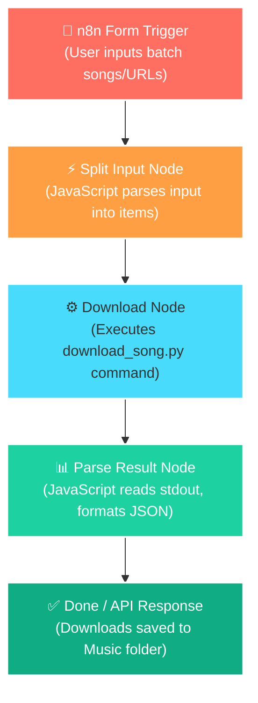

# 🎵 Automated Song Downloader (N8N & Python Pipeline)

[](https://n8n.io/)
[](https://python.org/)
[](https://flask.palletsprojects.com/)
[](https://microsoft.com/)

A powerful, production-grade automated song downloading pipeline that merges the visual orchestrating power of **n8n** with a high-performance **Python & yt-dlp/spotdl** backend. It processes track names, YouTube videos, YouTube playlists, and Spotify links in bulk, downloading them concurrently in the best audio quality, maintaining an archive to prevent duplicate downloads, and generating a detailed CSV log.

---

## 🤖 The Core Automation Engine: n8n Workflow

This project is built around an **automation-first architecture**. Instead of manually downloading songs or running terminal scripts, the entire pipeline is orchestrated by an **n8n workflow** that handles the request lifecycle.



### N8N Workflow Nodes Breakdown

1. **Form Trigger (`Form Trigger`)**: 
   An interactive web-based interface where users paste search queries or URLs (one per line). It serves as the primary webhook entrance.
2. **Split Input (`Code Node - JS`)**:
   Splits the raw text area value by newlines, trims whitespace, filters empty lines, and outputs a clean batch list.
   ```javascript
   const raw = $input.first().json['Songs'];
   const songs = raw.split('\n').map(s => s.trim()).filter(s => s.length > 0);
   if (songs.length === 0) throw new Error('No input provided!');
   return songs.map((q, i) => ({ json: { query: q, index: i+1, total: songs.length } }));
   ```
3. **Download CLI Executor (`Execute Command Node`)**:
   Executes the local python script using safe shell arguments to download and convert the track:
   ```bash
   python C:\Users\RJ\automation\download_song.py "{{ $json.query }}" "C:\Users\RJ\Music\AutoDownloads"
   ```
4. **Parse Result (`Code Node - JS`)**:
   Captures standard output, parses the Python script's JSON string, and structures it into metadata keys (`status`, `title`, `uploader`, `filepath`, `file_size_mb`, `url`) for downstream automations (e.g. notifications, database logging, or media library sync).

---

## ✨ Features

- **🌐 Multi-Source Routing**: Automatically routes links from YouTube (videos & playlists) and Spotify (tracks & playlists), or falls back to YouTube search queries for plain text track names.
- **⚡ Concurrent Downloading**: Employs Python `ThreadPoolExecutor` (4 parallel threads) for fast processing of playlists.
- **🛡️ Smart Deduplication**: Features a persistent binary database log (`.downloaded.txt`) that skips already downloaded songs, saving bandwidth and disk space.
- **📊 Logging & Transparency**: Appends every action to a shared `download_log.csv` tracking timestamps, download status, file paths, and metadata.
- **🖥️ Dual Interface**: Use the n8n automation pipeline or run the Flask-based Web UI / REST API.

---

## 📁 Repository Structure

```
AUTOMATION-SONG/
│
├── app.py                      # Flask API & GUI host
├── download_song.py            # Core Python Downloader CLI (called by n8n)
├── n8n_workflow.json           # Pre-configured n8n workflow definition
├── setup.ps1                   # Automated setup script (Installs Node, n8n, Python packages, FFmpeg)
├── Start Downloader.bat        # Double-click launcher for local Flask GUI
├── .gitignore                  # Git ignore files configuration
└── templates/
    └── index.html              # Frontend UI for Flask server
```

---

## 🚀 Setup & Installation

### 1. Automated Script Setup
Right-click PowerShell, select **Run as Administrator**, navigate to this folder, and run:
```powershell
Set-ExecutionPolicy -Scope Process -ExecutionPolicy Bypass
.\setup.ps1
```
This script will:
- Check for Python and install Python requirements (`yt-dlp`, `spotdl`, `flask`).
- Check for Node.js and install `n8n` globally.
- Set up necessary Windows environment configurations.
- Configure folder paths (`C:\Users\RJ\automation` and `C:\Users\RJ\Music\AutoDownloads`).

### 2. Import the Workflow into n8n
1. Start n8n in your command prompt:
   ```bash
   n8n start
   ```
2. Open n8n in your browser (usually `http://localhost:5678`).
3. Click the menu -> **Workflows** -> **Import from file...** and select [n8n_workflow.json](file:///d:/AI%20STUFF/PROJECTS/automated%20song%20downloader/n8n_workflow.json).
4. Save and activate the workflow.

---

## 🛠️ Usage

### Via n8n Form (Recommended)
1. Open your active workflow's Form URL inside n8n.
2. Enter your songs or playlist links.
3. Press **Submit**. Watch the workflow pull metadata and download your music in real-time.

### Via Flask GUI / API
Double-click `Start Downloader.bat`. It will spin up a web server at `http://127.0.0.1:5000` and open your default browser with a visual dashboard.

### Standalone CLI
You can execute downloads directly from terminal:
```bash
python download_song.py "https://open.spotify.com/track/..."
```

---

## 📝 Technologies Used
* **Automation Orchestrator**: [n8n](https://n8n.io/)
* **Media Downloader & Converter**: [yt-dlp](https://github.com/yt-dlp/yt-dlp) & [spotdl](https://github.com/spotdl/spotify-downloader)
* **Backend Web Server**: Python Flask
* **Automation Scripting**: PowerShell v5
