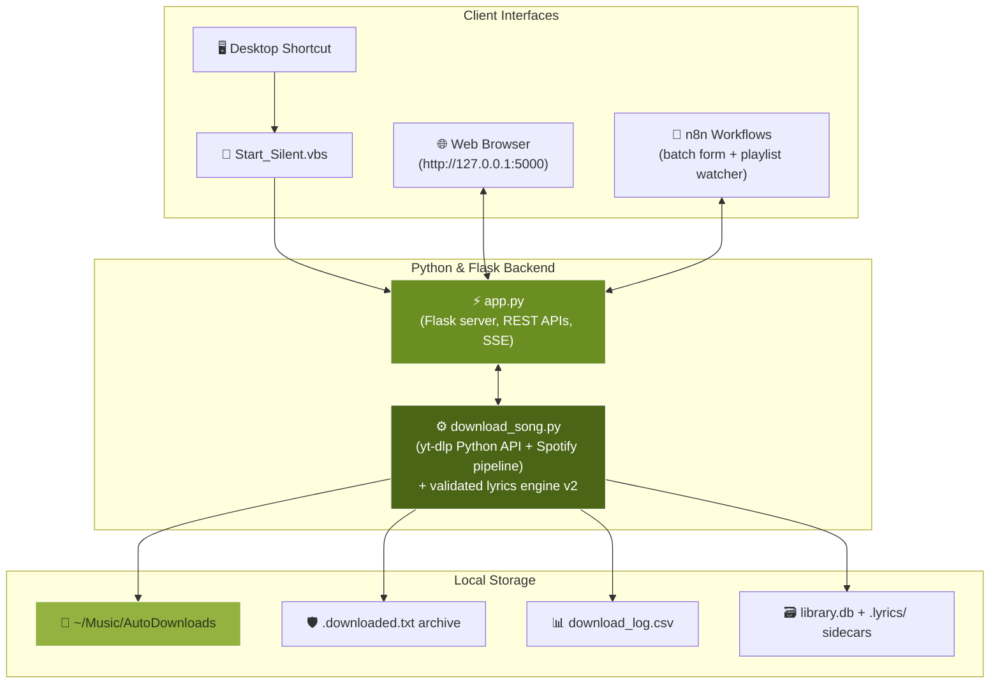

# 🎵 AuraDisc Pro — Automated Song Downloader & Music Hub

<div align="center">


[](https://python.org/)
[](https://flask.palletsprojects.com/)
[](https://github.com/yt-dlp/yt-dlp)
[](https://threejs.org/)
[](https://n8n.io/)
[](https://microsoft.com/)

**An all-in-one automated music downloader, WebGL streaming turntable, dual-language karaoke player, and n8n automation pipeline — for local use on Windows.**

[Features](#-key-features) • [1-Click Launch](#-1-click-desktop-launch) • [Architecture](#-system-architecture) • [API Reference](#-api-reference) • [Setup](#-installation--setup)

</div>

---

## ✨ Key Features

### 1. 🎨 AuraDisc Pro Design System
- **White base + olive green accents**, Comfortaa typography app-wide (Comfortaa Bold for karaoke lines, Noto Nastaliq Urdu for Urdu script).
- **Real-time 3D turntable**: a WebGL disc rendered with Three.js and custom shaders — dark olive vinyl with micro-grooves, procedural hub label drawn from the playing track, spin easing, mouse-parallax tilt, and a glide transition when the track changes.
- **Web Audio visualizer**: an orbital ring of ~900 particles reacts live to low/mid/high frequency bands.
- Graceful CSS fallback disc when WebGL is unavailable; respects `prefers-reduced-motion`.

### 2. 🖥️ 1-Click Desktop Launcher
- Double-click the **Auto Song Downloader** desktop icon (`Start_Silent.vbs`) — runs silently and opens `http://127.0.0.1:5000`.

### 3. ⚡ Downloads Engine
- **Universal input**: YouTube videos/playlists, Spotify tracks/albums/playlists, YouTube Music links, and plain-text search queries.
- **Async job queue**: downloads run in a thread pool; the UI streams live progress over **SSE** (`/api/jobs/<id>/events`) with one-click cancel.
- **Smart source selection**: fetches the top 8 YouTube candidates and scores them (penalizes live/remix/sped-up variants, boosts official/topic channels, validates duration) before downloading.
- **Robustness ladder**: automatic player-client cycling (`android/web → tv → mweb → ios`) with exponential backoff on transient errors; optional browser-cookie fallback via `config.json`.
- **Spotify pipeline**: metadata with graceful fallbacks, proper `<artist> - <title>` naming, mutagen tagging (iTunes gap-fill), and dual YouTube+Spotify dedupe-archive keys.
- **Format options**: MP3 320k · FLAC lossless · Hi-Res (96kHz/24-bit).

### 4. 🎤 Dual-Language Karaoke Lyrics
- Synced `.lrc` playback with stacked **Urdu Nastaliq + English/Roman** lines, auto-scrolling highlight, click-to-seek, and an immersive fullscreen mode (`F`).
- **Correctness-first engine v2**: synced LRC only; every candidate is hard-gated on **duration (±12 s vs the real audio file)** and title/artist token overlap; fuzzy search picks the *best-scored* match, never the first hit. No confident match → no lyrics (wrong subs are impossible rather than likely).
- **Provenance & negative cache**: per-track source + timestamp in `.lyrics/.index.json`; unmatched tracks skip the network for 7 days.
- **Rebuild tools**: 🧹 button wipes every sidecar and re-fetches in a background thread; per-track refresh icon re-fetches a single song. On-demand generators add romanized (offline transliteration) and English translation sidecars.

### 5. 🎧 Library, Playlists & Player Extras
- **SQLite-backed library** (`library.db`): play counts, durations, search history — filesystem stays the source of truth.
- **Playlists**: build from selected tracks, filter the vault by playlist, export **M3U**.
- **Player**: shuffle, repeat off/all/one, auto-fade between tracks, volume slider + mute, scrubber seeking.
- **Keyboard shortcuts**: `Space` play/pause · `←/→` seek ±10 s · `↑/↓` volume · `N/P` next/prev · `F` fullscreen lyrics · `Esc` close.
- **Media Session API**: Windows media keys and lock-screen controls work out of the box, artwork included.

### 6. 🛡️ Housekeeping
- Persistent dedupe archive (`.downloaded.txt`) prevents double downloads; serialized CSV logging.
- System diagnostics endpoint incl. an "yt-dlp outdated" hint when PyPI is newer than the installed copy.

---

## 🛠️ System Architecture



---

## 🚀 1-Click Desktop Launch

Double-click the **Auto Song Downloader** desktop icon. To re-create the shortcut:

```powershell
powershell -ExecutionPolicy Bypass -File "Create_Desktop_Shortcut.ps1"
```

Launchers: [`Start_Silent.vbs`](Start_Silent.vbs) (silent + browser open) and [`Start Downloader.bat`](<Start Downloader.bat>) (visible console).

---

## 📡 API Reference

| Method | Endpoint | Description | Payload / Response |
| :--- | :--- | :--- | :--- |
| `POST` | `/api/download` | Single track/playlist download. `"mode":"async"` returns `{job_id}` (202) instantly | `{ "query": "...", "format": "mp3", "quality": "0" }` |
| `POST` | `/api/batch_download` | Concurrent multi-query batch | `{ "queries": [...], "format": "mp3" }` |
| `GET` | `/api/jobs` / `/api/jobs/<id>` | Job list / poll one job | `{ "job": { "progress": 42, ... } }` |
| `GET` | `/api/jobs/<id>/events` | Live SSE progress stream | `text/event-stream` |
| `POST` | `/api/jobs/<id>/cancel` | Cancel queued/running job | — |
| `GET` | `/api/library` | Vault listing (+ play counts, durations) | `{ "status": "success", "library": [...] }` |
| `POST` | `/api/plays` | Increment play count | `{ "filename": "Song.mp3" }` |
| `GET`/`POST` | `/api/history` | Search history | `{ "query": "..." }` |
| `GET`/`POST` | `/api/playlists` | List / create playlists | `{ "name": "Mix", "tracks": ["a.mp3"] }` |
| `GET` | `/api/playlists/<name>/export.m3u` | Export M3U | M3U file |
| `GET` | `/api/stream/<filename>` | Stream audio to browser | HTML5 Audio stream |
| `GET`/`POST` | `/api/lyrics` | Synced lyrics (+`?refresh=true` re-fetches one track) | `{ "synced": true, "lyrics_by_lang": {...} }` |
| `POST` | `/api/lyrics/generate` | Generate romanized/translated sidecars | `{ "filename": "Song.mp3", "translate": false }` |
| `POST` | `/api/lyrics/refresh` | Orphan purge + reindex; `{"purge_all":true}` = wipe ALL lyrics and rebuild in background | `{ "purge_all": true }` |
| `POST` | `/api/watch/sync` | Watched-playlist sync: downloads only new tracks | `{ "playlist_url": "..." }` |
| `POST` | `/api/open_folder` | Open music folder in Explorer | — |
| `GET` | `/api/system_info` | Diagnostics incl. yt-dlp outdated hint | `{ "diagnostics": {...} }` |
| `POST` | `/api/delete` | Delete a track from disk | `{ "filename": "Song.mp3" }` |

Optional `config.json` (see [`config.example.json`](config.example.json)) overrides paths, concurrency, auto-tagging/lyrics toggles, loudness normalization, browser-cookie fallback, and the watched Spotify playlist.

---

## ⚙️ Installation & Setup

### 1. Automated setup (Windows, admin PowerShell)
```powershell
Set-ExecutionPolicy -Scope Process -ExecutionPolicy Bypass
.\setup.ps1
```
Installs Python deps, FFmpeg (winget), and n8n.

### 2. Manual
```powershell
pip install -r requirements.txt
python app.py            # -> http://127.0.0.1:5000
```

### 3. Tests
```powershell
python -m pytest tests/ -q   # lyric matcher unit tests (no network)
```

> Tip: if extraction errors appear after YouTube changes, upgrade first: `yt-dlp -U` (or `pip install -U yt-dlp`).

---

## 📁 Repository Structure

```
AUTOMATION-SONG/
├── app.py                       # Flask server, REST APIs, async jobs, SSE
├── download_song.py             # yt-dlp/Spotify engine + validated lyrics engine v2
├── tests/
│   └── test_lyric_matching.py   # Unit tests for filename parsing & candidate gating
├── templates/
│   └── index.html               # AuraDisc Pro frontend (Tailwind CDN + Three.js)
├── n8n_workflow.json            # Batch download form workflow
├── n8n_watch_workflow.json      # Cron playlist-watcher workflow
├── config.example.json          # Template for optional config.json overrides
├── setup.ps1                    # Automated dependency installer
├── Create_Desktop_Shortcut.ps1  # Shortcut generator
├── Start_Silent.vbs / Start Downloader.bat
├── AGENTS.md                    # Contributor/agent guide (commands, architecture facts)
└── README.md
```

---

## 📝 Technologies Used
- **Frontend**: Tailwind CSS (Play CDN), vanilla JS, **Three.js r128** (WebGL turntable), **Web Audio API** (FFT visualizer), Comfortaa + Noto Nastaliq Urdu fonts
- **Backend**: Python 3.10+, Flask, yt-dlp (in-process API), spotipy/mutagen, SQLite, ThreadPoolExecutor
- **Lyrics**: LRCLIB (primary), Musixmatch/NetEase via syncedlyrics (fallback), offline romanizer + Google-translate sidecar generator
- **Automation**: [n8n](https://n8n.io/) workflows (batch form + cron watch/sync)

---

<div align="center">
  <sub>Built for seamless music downloading, streaming, and singing along.</sub>
</div>
