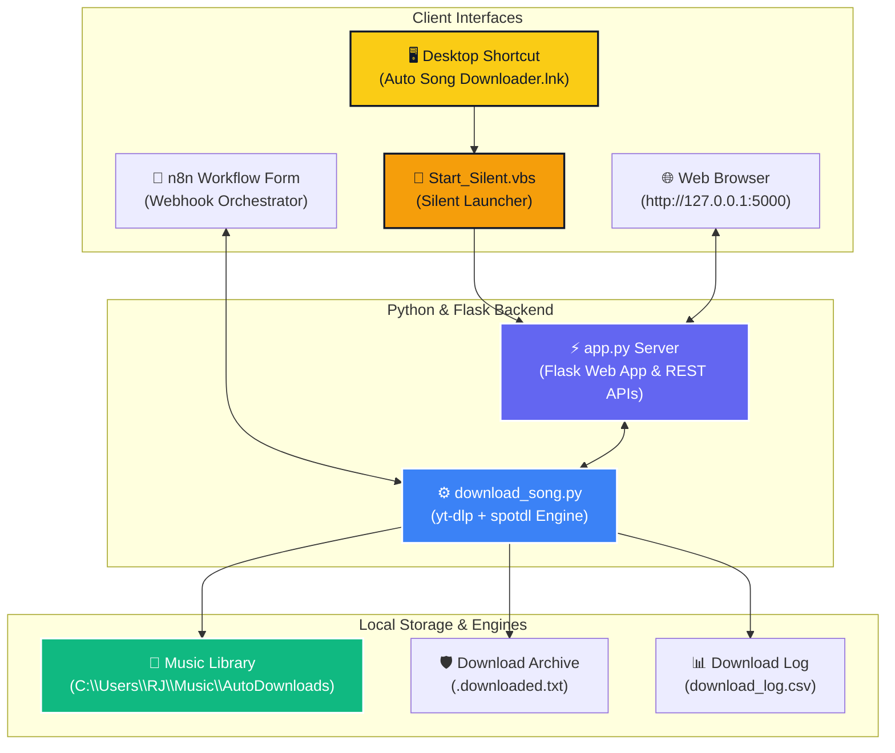

# 🎵 Auto Song Downloader Pro & Music Hub

<div align="center">


[](https://python.org/)
[](https://flask.palletsprojects.com/)
[](https://github.com/yt-dlp/yt-dlp)
[](https://github.com/spotdl/spotify-downloader)
[](https://n8n.io/)
[](https://microsoft.com/)

**An all-in-one, high-performance automated music downloader, local audio streaming player, library manager, and n8n automation pipeline.**

[Features](#-key-features) • [1-Click Launch](#-1-click-desktop-launch) • [Architecture](#-system-architecture) • [API Reference](#-api-reference) • [Setup](#-installation--setup)

</div>

---

## ✨ Key Features

### 1. 🖥️ 1-Click Desktop Launcher
- **Instant Browser Access**: Double-click the **Auto Song Downloader** icon generated directly on your Desktop (`Auto Song Downloader.lnk`).
- **Silent Background Execution**: Runs silently via [`Start_Silent.vbs`](file:///d:/AI%20STUFF/PROJECTS/automated%20song%20downloader/Start_Silent.vbs) without leaving open terminal windows, automatically launching your default web browser to `http://127.0.0.1:5000`.

### 2. 🎨 Cool Yellow & Off-White Design System
- **State-of-the-Art Aesthetic**: Built with a **Sonic Yellow (`#FACC15`)** and **Off-White (`#FAF9F5`)** color palette.
- **Glassmorphic Cards**: Pure white (`#FFFFFF`) containers with crisp border strokes, soft multi-layered shadows, and smooth micro-interactions.

### 3. 🎧 In-Browser Audio Streaming & Player Widget
- **Play Anywhere**: Listen to downloaded songs directly inside your browser without opening third-party media players.
- **Floating Vinyl Bar**: Interactive audio bar complete with spinning vinyl disc animation, seek bar, time display, volume controls, and a 1-click **Close `(X)` Button** to stop playback and hide the player.

### 4. 🎵 Music Library & Explorer Manager
- **Live Search & Filter**: Instantly search your library by song title, artist, or file format.
- **File Metadata & Tags**: Displays format tags (`MP3`, `FLAC`, `M4A`, `WAV`), file size in MB, and download dates.
- **Open Downloads Folder Button**: Opens your local music destination (`C:\Users\RJ\Music\AutoDownloads`) directly in Windows File Explorer with one click.
- **1-Click Track Deletion**: Cleanly delete tracks from disk directly from the Web UI.

### 5. ⚡ Multi-Source & Multi-Line Batch Queue
- **Universal Input Support**: Handles YouTube video URLs, YouTube playlists, Spotify tracks/playlists, YouTube Music links, and plain text song search queries.
- **Batch Queue Downloader**: Paste multiple URLs or titles line-by-line in the text area to process batch downloads concurrently.
- **Concurrent Processing**: Multithreaded execution using Python `ThreadPoolExecutor` for fast multi-track downloading.

### 6. 📊 System Diagnostics Dashboard
- **Health Diagnostics Tab**: Real-time status reporting for Python, yt-dlp, FFmpeg audio encoder, spotdl, total download count, and disk space usage.

### 7. 🛡️ Duplicate Prevention & CSV Logging
- **Smart Archive**: Uses a persistent archive file (`.downloaded.txt`) to avoid downloading identical songs twice.
- **Transparent CSV Logs**: Appends every completed task to `download_log.csv` with timestamps, file size, artist name, and file path.

---

## 🛠️ System Architecture



---

## 🚀 1-Click Desktop Launch

Simply double-click the **Auto Song Downloader** icon on your Desktop!

- **Target Script**: [`Start_Silent.vbs`](file:///d:/AI%20STUFF/PROJECTS/automated%20song%20downloader/Start_Silent.vbs)
- **Batch Launcher**: [`Start Downloader.bat`](file:///d:/AI%20STUFF/PROJECTS/automated%20song%20downloader/Start%20Downloader.bat)
- **Re-create Desktop Shortcut**:
  ```powershell
  powershell -ExecutionPolicy Bypass -File "Create_Desktop_Shortcut.ps1"
  ```

---

## 📡 API Reference

The Flask backend provides RESTful JSON endpoints for external integration:

| Method | Endpoint | Description | Payload / Response |
| :--- | :--- | :--- | :--- |
| `POST` | `/api/download` | Single track or playlist download | `{ "query": "Song or URL", "format": "mp3", "quality": "0" }` |
| `POST` | `/api/batch_download` | Process multi-line batch download queue | `{ "queries": ["Song 1", "Song 2"], "format": "mp3" }` |
| `GET` | `/api/library` | List all downloaded music files with metadata | `{ "status": "success", "library": [...] }` |
| `GET` | `/api/stream/<filename>` | Stream audio file directly to browser | HTML5 Audio Stream (`audio/mpeg`, etc.) |
| `POST` | `/api/open_folder` | Opens `AutoDownloads` in Windows File Explorer | `{ "status": "success", "message": "Opened folder" }` |
| `GET` | `/api/system_info` | Get system status for Python, yt-dlp, FFmpeg | `{ "diagnostics": { "ffmpeg": "...", "total_files": 16 } }` |
| `POST` | `/api/delete` | Delete a music file from disk | `{ "filename": "Song.mp3" }` |

---

## ⚙️ Installation & Setup

### 1. Automated Setup Script
Run PowerShell as **Administrator** inside this project directory:
```powershell
Set-ExecutionPolicy -Scope Process -ExecutionPolicy Bypass
.\setup.ps1
```
This script automatically:
- Checks Python and installs required packages (`yt-dlp`, `spotdl`, `flask`).
- Checks Node.js and installs `n8n` globally.
- Installs `FFmpeg` via `winget`.
- Configures environment variables and output directories.

### 2. Manual Server Startup
```bash
python app.py
```
Open `http://127.0.0.1:5000` in your web browser.

---

## 📁 Repository Structure

```
AUTOMATION-SONG/
├── app.py                      # Flask Server, REST APIs, & Streaming Engine
├── download_song.py            # Core Media Extraction Engine (yt-dlp + spotdl)
├── Create_Desktop_Shortcut.ps1 # PowerShell Desktop Shortcut Generator
├── Start_Silent.vbs            # Silent Background Window Launcher
├── Start Downloader.bat        # Command Launcher Script
├── setup.ps1                   # Automated Setup & Dependency Installer
├── n8n_workflow.json           # n8n Orchestrator Workflow import file
├── README.md                   # Application Documentation
└── templates/
    └── index.html              # Cool Yellow & Off-White Frontend Interface
```

---

## 📝 Technologies Used
* **Frontend**: HTML5, CSS3 Vanilla Glassmorphism, JavaScript ES6+
* **Backend API**: Python 3.14, Flask
* **Media Extraction**: [yt-dlp](https://github.com/yt-dlp/yt-dlp) & [spotdl](https://github.com/spotdl/spotify-downloader)
* **Audio Encoder**: FFmpeg
* **Automation Orchestrator**: [n8n](https://n8n.io/)
* **Operating System**: Windows 11

---

<div align="center">
  <sub>Built with ❤️ for Seamless Music Downloading & Local Streaming.</sub>
</div>
